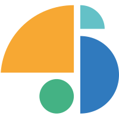



<h3 align="center">

</h3>
<h3 align="center"><strong>Ready. Sell. Grow.</strong></h3>

    A modular, scalable, and ultra-fast open-source all-in-one eCommerce platform built on ASP.NET Core 10.

<a href="https://github.com/behnamaltafi/BonakMarketFamily">Repository</a> &#8729;
<a href="https://dev.smartstore.com">Upstream developer guide</a> &#8729;
<a href="dev-docs/rename-safety.md">Rename &amp; deployment safety</a>

 

  

 

BonakMarket is a cross-platform, modular, scalable, and ultra-fast open-source all-in-one eCommerce platform built on `ASP.NET Core 10`, `Entity Framework Core 10`, `Vue.js`, `Sass`, `Bootstrap`, and more.

**BonakMarket includes all the essential features to create multi-language, multi-store, and multi-currency shops**, with built-in AI capabilities for text and image generation powered by the world's leading AI providers — targeting desktop and mobile devices alike. It enables SEO-optimized, rich product catalogs with support for an unlimited number of products and categories, variants, bundles, datasheets, ESD, discounts, coupons, and much more.

A comprehensive set of tools for CRM & CMS, sales, marketing, payment, and shipping makes BonakMarket a powerful all-in-one solution that meets all your needs.

**BonakMarket delivers a beautiful and fully configurable storefront out of the box**, built with a high-level design approach using `Sass`, `Bootstrap`, and other modern components. The included *Flex* theme is modern, clean, and fully responsive — giving shoppers the best possible experience on any device.

The state-of-the-art architecture — with `ASP.NET Core 10`, `Entity Framework Core 10`, and a domain-driven design approach — makes BonakMarket easy to extend, extremely flexible, and a pleasure to work with.

* **Repository:** [BonakMarketFamily](https://github.com/behnamaltafi/BonakMarketFamily)
* **Upstream:** [Smartstore](https://github.com/smartstore/Smartstore)
* **Upstream developer guide:** [dev.smartstore.com](https://dev.smartstore.com)

&nbsp;

## Technology & Design

- State-of-the-art architecture with `ASP.NET Core 10`, `Entity Framework Core 10`, and domain-driven design
- Cross-platform: runs on Windows, Linux, and macOS
- `Docker` support out of the box for easy deployment
- Composable, extensible, and highly flexible through a modular architecture
- Highly scalable with full-page caching and web farm support
- Powerful theme engine for creating or customizing themes and skins with minimal effort, thanks to theme inheritance
- Point & Click theme configuration
- Liquid template engine: highly flexible templating for emails and campaigns, with auto-completion and syntax highlighting
- HTML-to-PDF converter: generates PDF documents from standard HTML templates, greatly simplifying PDF output customization
- Consistent use of modern components such as `Vue.js`, `Sass`, and `Bootstrap` across both frontend and backend
- Intuitive shop management through a modern, clean UI

&nbsp;

## Key Features

  

- Multi-store support
- Multi-language with full RTL (right-to-left) and bidirectional text support
- Multi-currency support
- Product bundles, variants, attributes, ESD, tier pricing, cross-selling, and more
- Sophisticated marketing and promotion capabilities (gift cards, reward points, discounts of any kind, and more)
- AI-powered features for text and image generation, image editing, and image composition
- CMS Page Builder: create compelling, sales-driving content without any coding, using a powerful WYSIWYG editor with a CSS grid system
- Reviews and ratings
- Media Manager: powerful, lightning-fast media file explorer
- Rule Builder: visual business rule creation with dozens of predefined rules out of the box
- Search framework with faceted search support — ultra-fast results even with millions of items
- Extreme scalability through output caching, `Redis`, and `Microsoft Azure` support
- Tree-based permission management (ACL) with inheritance support
- Comprehensive import/export framework (profiles, filters, mapping, projections, scheduling, deployment, and more)
- Blog, forum, polls, custom pages, and HTML content
- CMS Menu Builder: visual manager for all menu types — modify existing menus or create your own and place them anywhere
- Modern, clean, SEO-optimized, and fully responsive `Bootstrap`-based theme
- Hierarchical SEO slug support, e.g. *samsung/galaxy/s22/32gb/white*
- *Trusted Shops* pre-certification and full EU GDPR compliance
- 100% compliant with German law
- Sales, customer, and inventory management
- Comprehensive CRM features
- Powerful layered navigation
- Numerous payment and shipping providers and options
- Wallet: supports full or partial order payment via credit account
- TinyImage: achieves ultra-high image compression rates (up to 80%) with WebP support
- Preview Mode: easily test themes and stores before going live
- RESTful Web API

&nbsp;

## AI Features

BonakMarket comes with a built-in AI framework that brings generative AI directly into the merchant workflow — no third-party plugins required.

### Capabilities

- **Text generation**: AI-assisted creation and optimization of product descriptions, meta tags, category texts, and other shop content
- **Image generation**: Create product and marketing images from text prompts directly within the backend
- **Image editing**: Modify and enhance existing images using AI (background removal, retouching, style transfer, and more)
- **Image composition**: Combine and merge multiple images into a single, cohesive result

### Supported AI Providers

BonakMarket integrates with all major AI providers through a unified, provider-agnostic abstraction layer. Switch or combine providers at any time without changing your workflow:

| Provider | Text Generation | Image Generation |
|---|:---:|:---:|
| [OpenAI / ChatGPT](https://openai.com/) | ✔ | ✔ |
| [Google Gemini](https://gemini.google.com/) | ✔ | ✔ |
| [Anthropic Claude](https://www.anthropic.com/) | ✔ | — |
| [DeepSeek](https://www.deepseek.com/) | ✔ | — |
| [Ollama](https://ollama.com/) *(self-hosted)* | ✔ | — |

&nbsp;

## Getting Started

### System Requirements

#### Supported Operating Systems

- Windows 10 or higher / Windows Server 2016 or higher
- Ubuntu 18.04+
- Debian 11+
- macOS 10.11+

#### Supported Database Systems

- Microsoft SQL Server 2016 Express or higher
- MySQL 8.0+
- PostgreSQL 11+
- SQLite 3.31+

### Existing Smartstore installations

This is a renamed and customized fork, not an in-place, automatically compatible upgrade. Before using it with an existing database, read [rename and deployment safety](dev-docs/rename-safety.md). Back up the **SQL Server database** and **App_Data/Tenants** first. Do not delete installation markers, replace tenant settings blindly, or run migrations on the production database before validating them against a backup.

### Visual Studio

1. Clone the repository: `git clone https://github.com/behnamaltafi/BonakMarketFamily.git` and check out the `feature/change-name-of-project` branch.
2. Download [Visual Studio 2026](https://www.visualstudio.com/downloads/) (any edition).
3. Open `BonakMarket.sln` and wait for Visual Studio to restore all NuGet packages.
4. Set `BonakMarket.Web` as the startup project and run it.

### Repository Structure

| Project | Description |
|---|---|
| [`BonakMarket`](src/BonakMarket) | Common low-level, application-agnostic infrastructure: bootstrapper, modularity engine, caching, pub/sub, imaging, type conversion, I/O, templating, scheduling, utilities, and extension methods |
| [`BonakMarket.Data`](src/BonakMarket.Data) | Database providers |
| [`BonakMarket.Core`](src/BonakMarket.Core) | Application-specific modules: catalog, checkout, identity, security, localization, logging, messaging, rules engine, search engine, theme engine, migrations, and more |
| [`BonakMarket.Web.Common`](src/BonakMarket.Web.Common) | Common web features: custom MVC infrastructure, bundling, Tag Helpers, HTML helpers, and more |
| [`BonakMarket.Modules`](src/BonakMarket.Modules) | All module and plugin projects |
| [`BonakMarket.Web`](src/BonakMarket.Web) | Entry host project: controllers, model classes, themes, and static assets |

&nbsp;

## Building BonakMarket

### Option 1 — Publish from Visual Studio

1. Open the BonakMarket solution in Visual Studio 2026.
2. Switch to the **Release** configuration.
3. Rebuild the solution.
4. Publish the **BonakMarket.Web** host project.

### Option 2 — Run a build script

Run the build script for your target platform from the **build** directory: `build.{Platform}.cmd`. The output is placed in `build/artifacts/Community.{Version}.{Platform}` and a zip archive is created in `build/artifacts/` automatically.

By default, the script produces a self-contained, platform-specific application that bundles the ASP.NET runtime, so it runs on any machine without a pre-installed .NET runtime.

BonakMarket uses [Nuke](https://nuke.build/) as its build automation solution. You can customize the build process by editing `src/BonakMarket.Build/BonakMarket.Build/Build.cs`.

### About the `src/BonakMarket.Web/Modules` Directory

During the build, all modules in `src/BonakMarket.Modules/` are detected, compiled, and placed in `src/BonakMarket.Web/Modules/`. The runtime loads modules dynamically from this directory. During development this folder is not required — you can safely delete it at any time.

### Creating Docker Images

Run `build/dockerize.{Platform}[.nobuild].sh` to create a Docker image.

#### `dockerize.linux.sh`

Builds a Debian Linux base image with the full ASP.NET runtime, compiles the solution, and publishes a framework-dependent application inside the container. Also installs the native **wkhtmltopdf** library required for PDF generation.

#### `dockerize.linux.nobuild.sh`

Faster alternative — skips the build step. Requires a pre-built artifact in `build/artifacts/Community.{Version}.linux-x64`. Creates a Debian Linux base image with only the ASP.NET runtime dependencies and copies the artifact. Also installs **wkhtmltopdf**.

#### `dockerize.windows.nobuild.sh`

Creates a Windows Nano Server base image with only the ASP.NET runtime dependencies and copies the artifact from `build/artifacts/Community.{Version}.win-x64`. Requires the Docker engine to be running a Windows image.

### Creating Docker Containers

Run `compose.{DbSystem}.sh` to create a ready-to-use Docker container that includes a database server.

#### `compose.mysql.sh`

Creates a composite Docker container with the **BonakMarket** application image and the latest **MySQL** image.

#### `compose.sqlserver.sh`

Creates a composite Docker container with the **BonakMarket** application image and the latest **MS SQL Server** image.

&nbsp;

## Deployment safety

This fork does not currently publish a verified public live demo. Validate build, startup, authentication/SMS and database compatibility in staging before publishing to IIS or production. See [rename and deployment safety](dev-docs/rename-safety.md).

## License

BonakMarketFamily is a customized fork of [Smartstore](https://github.com/smartstore/Smartstore), originally developed by Smartstore AG. Original authorship and copyright notices remain applicable. The community code is distributed under the [GNU AGPL v3](https://www.gnu.org/licenses/agpl-3.0.html); review the repository license and third-party component licenses before redistributing.

&#11088; **Star this repository** to stay up to date, follow our progress, and never miss a new release. Contributions and community involvement are always welcome.